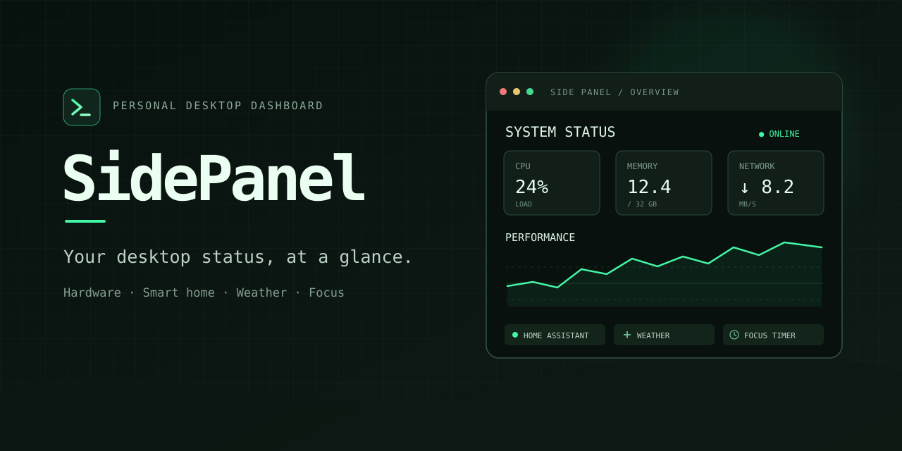
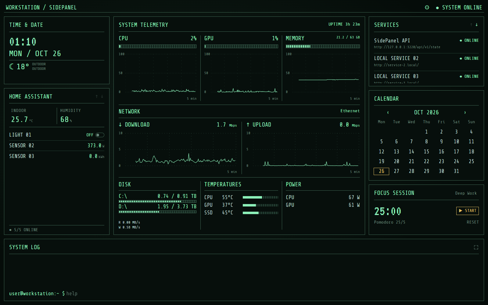
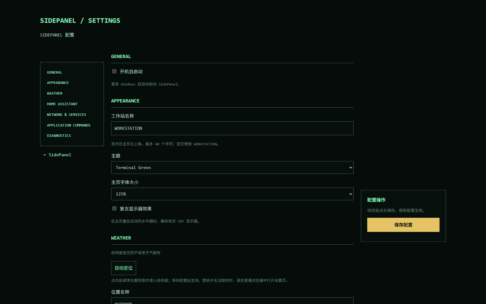
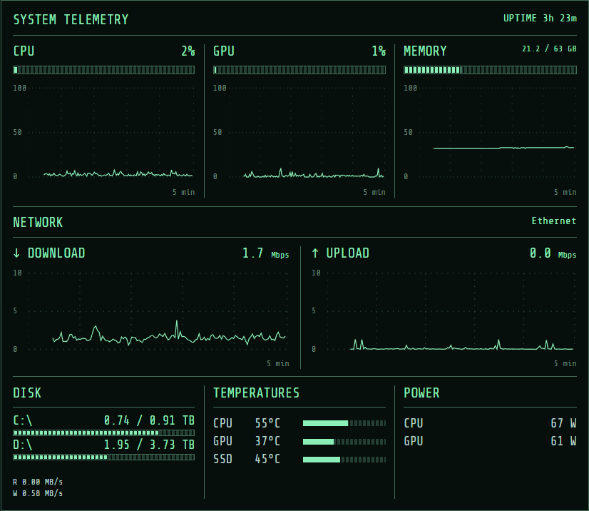
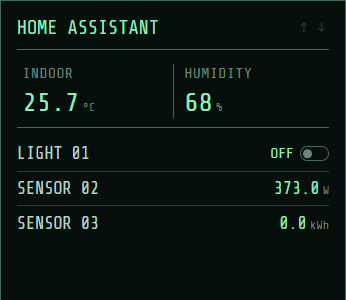
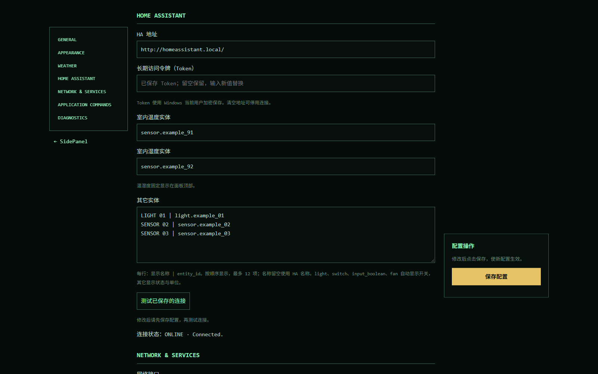
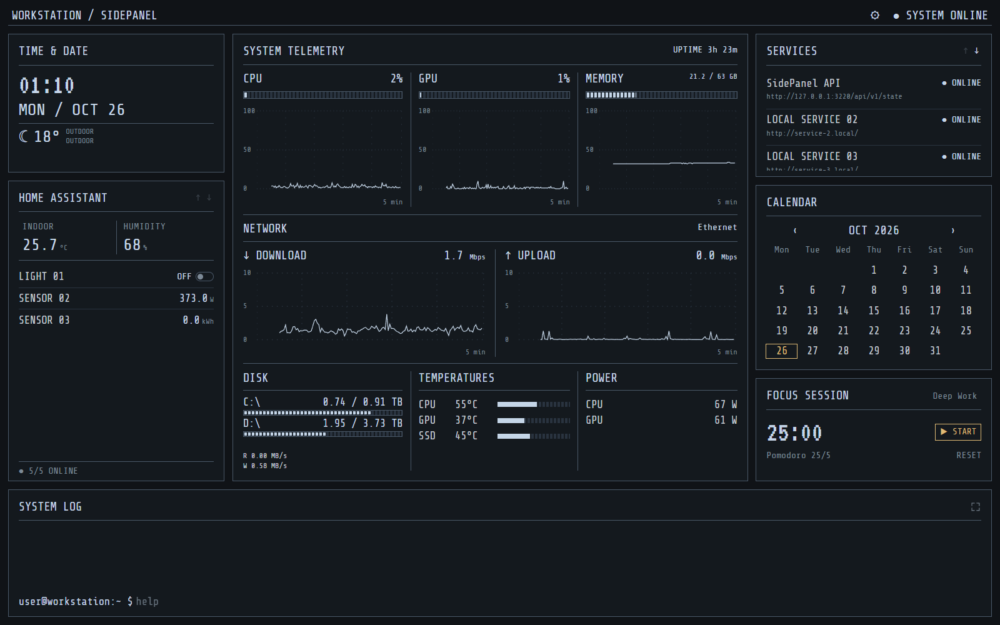
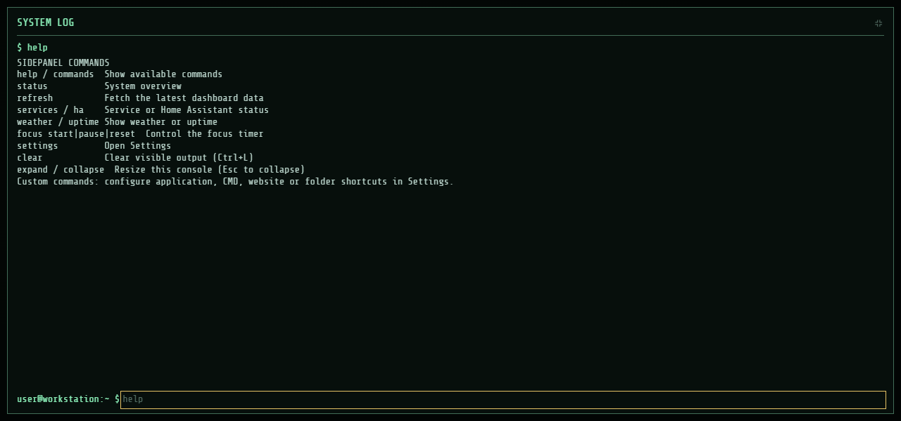
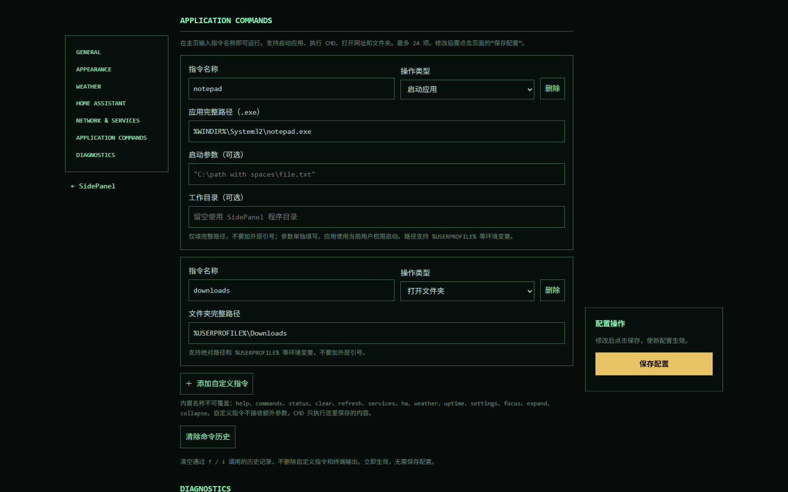

<div align="center">



# SidePanel

**让副屏成为你的桌面状态面板**

硬件监控、智能家居、天气与日程，在一张终端风格的页面里。

[安装与使用](#安装与使用) · [功能介绍](#功能介绍) · [更新与备份](#更新与备份) · [更新日志](Changelog.md) · [常见问题](#常见问题)



</div>

## 安装与使用

### 1. 准备运行环境

使用 **Windows x64** 电脑，并安装 **.NET 10 Desktop Runtime x64**。

前往 [微软 .NET 10 下载页面](https://dotnet.microsoft.com/zh-cn/download/dotnet/10.0)，在 **“.NET 桌面运行时”** 一栏选择 **Windows x64 安装程序**。已安装对应的 10.0.x 桌面运行时，可直接进入下一步。

### 2. 下载并启动

从本项目的 [Releases 发行页面](https://github.com/imrsp/SidePanel/releases)下载 `SidePanel-win-x64.zip`，解压到一个固定、可写入的位置，例如 `D:\Apps\SidePanel`，然后运行 `SidePanel.exe`。

**请保留解压后的完整目录，不要只移动 EXE 文件。** 程序使用绿色版目录，无需额外安装 SidePanel。

启动后，SidePanel 会进入 Windows 系统托盘，不弹出主窗口。在浏览器中打开：

```text
http://127.0.0.1:3220
```

也可以双击托盘图标打开面板。托盘图标可能收在任务栏的隐藏图标区域，右键菜单可打开页面、进入设置、切换自启动或退出程序。

### 3. 完成首次设置

点击面板右上角的设置按钮，或从托盘菜单进入设置。建议先完成以下几项，再点击 **“保存配置”**：

| 设置 | 作用 |
| --- | --- |
| 工作站名称、主题、字号 | 调整副屏上的显示效果与阅读距离 |
| 天气位置 | 使用“自动定位”或手动填写经纬度，启用天气显示 |
| 网络接口 | 自动选择网卡，或指定实际使用的有线 / 无线网卡 |
| Home Assistant | 按需填写地址、令牌和实体；不使用可留空 |
| 服务探测 | 按需添加希望查看在线状态的服务 |



保存后返回主页，将浏览器窗口移到副屏即可使用。需要沉浸显示时，可使用浏览器自身的全屏功能。

## 功能介绍

面板将时间与智能家居放在左侧，硬件和网络放在中央，服务、月历和专注计时放在右侧；底部是日志与应用控制台。

### 硬件与网络监控

集中查看 CPU、GPU、内存、磁盘和网络状态，适合在工作、游戏或运行长任务时随时查看。

| 区域 | 显示内容 |
| --- | --- |
| CPU / GPU | 当前使用率及最近约 5 分钟的变化曲线 |
| 内存 | 使用比例、已用容量和总容量 |
| 网络 | 下载 / 上传速率与变化曲线 |
| 磁盘 | 各固定磁盘的已用 / 总容量，以及磁盘读写速率 |
| 温度 | 可读取的 CPU、GPU 和存储设备温度 |
| 功率 | 可读取的 CPU / GPU 功率 |



硬件和网络通常每 **2 秒** 更新。曲线保留最近约 **5 分钟**，刷新页面或切换设置页后仍可恢复；退出程序后重新积累。

可读取的传感器取决于硬件、驱动和权限，不可用的值显示 `—`。部分传感器可能需要以管理员身份运行程序。功率显示采用设备提供的读数，不估算整机耗电量。

### Home Assistant 联动

将室内温湿度、灯光、开关及其它实体放到副屏上。温度和湿度有独立位置，其它实体按设置顺序排列，最多 **12 项**。

<p align="center">
  
</p>

**连接方法：**

1. 在设置的 **HOME ASSISTANT** 区域填写 HA 地址和长期访问令牌。
2. 填写温度、湿度实体；不需要的项可以留空。
3. 在“其它实体”中按每行 `显示名称 | entity_id` 填写，例如：

   ```text
   书桌灯 | light.desk
   空气净化器 | fan.air_purifier
   客厅功率 | sensor.living_room_power
   ```

4. 点击 **“保存配置”**，再使用 **“测试已保存的连接”** 检查结果。



`light`、`switch`、`input_boolean`、`fan` 提供开关控制；其它实体显示状态和单位。名称留空时使用 HA 提供的友好名称。连接失败会隐藏旧值并禁用控制，不存在或不可用的实体显示 `—`。

令牌按当前 Windows 用户加密保存在本机，页面不会回显已保存的令牌。修改其它设置时，令牌留空会保留原值；输入新令牌可替换，清空 HA 地址可停用连接。更换 Windows 用户后需要重新填写令牌。

### 两种主题，适配自己的桌面

**Terminal Green** 采用黑绿底色与薄荷绿文字；**Graphite** 使用深灰背景与冷色文字。两种主题都保留终端面板、细线图表与等宽字体。



主页字号支持 **100% / 125% / 150% / 200%**，可按屏幕尺寸和观看距离调整；复古扫描线效果也可在设置中开启或关闭。

### 天气、服务与日常小工具

**天气** 显示所选位置的当前温度与天气状态，约每 15 分钟更新。首次使用需要设置位置；使用自动定位时，请在浏览器中允许位置访问，也可手动填写经纬度。

**服务探测** 约每 30 秒检查一次，最多可配置 12 项，支持 HTTP、HTTPS 和 TCP。例如，在设置中按每行一项填写：

```text
SidePanel API | http://127.0.0.1:3220/api/v1/state
Home Assistant | http://homeassistant.local/
NAS SSH | tcp://nas.local:22
```

HTTP 服务以成功响应判断在线，TCP 服务检查端口连通性；它们反映的是探测结果。网络中断或服务需要认证时，请结合实际情况判断。

**月历** 按本机日期显示当前月份，支持前后翻月。**专注计时器** 支持开始、暂停和重置，刷新页面后仍可继续计时。

**开机时长** 按最近一次完整启动或快速启动计时；睡眠、休眠不会重置，期间计入时长。若系统启动事件不可读取，会回退使用系统计数器，此时可能跨越快速启动的关机周期。

### 应用内终端

在底部 **SYSTEM LOG** 输入指令，按 Enter 执行。可以查看状态、控制专注计时，或调用自己保存的应用快捷操作。右上角按钮可展开控制台，按 Esc 收起。



常用指令：

| 指令 | 功能 |
| --- | --- |
| `help` / `commands` | 查看帮助或全部内置、自定义指令名称 |
| `status` | 查看硬件、内存、磁盘及 HA 概况 |
| `refresh` | 获取最新可用快照 |
| `services` / `ha` | 查看服务探测或 HA 实体状态 |
| `weather` / `uptime` | 查看天气或开机时长 |
| `focus start` / `focus pause` / `focus reset` | 开始、暂停或重置专注计时 |
| `settings` | 打开设置页 |
| `clear` | 清空当前可见输出 |
| `expand` / `collapse` | 展开或收起控制台 |

<details>
<summary>键盘操作与历史记录</summary>

| 操作 | 效果 |
| --- | --- |
| Enter | 执行输入的指令 |
| ↑ / ↓ | 浏览历史；先输入前缀可匹配历史指令 |
| Tab | 补全指令名称 |
| Ctrl+L | 清空可见输出 |
| Esc | 收起展开的控制台 |

历史保存最近 500 条，连续重复指令不重复写入，重启程序后仍可调用。`clear` 和 Ctrl+L 不删除历史；如需删除，可在设置中点击“清除命令历史”。终端输出在本次运行中保留最近 120 条，刷新或切换页面可恢复，程序退出后清空。

</details>

### 自定义指令，把常用操作留在面板里

在设置的 **APPLICATION COMMANDS** 中添加操作，保存后输入指令名称即可调用，最多 **24 项**。

| 类型 | 可以做什么 | 填写示例 |
| --- | --- | --- |
| 启动应用 | 打开 `.exe`，可另填参数和工作目录 | `%WINDIR%\System32\notepad.exe` |
| 执行 CMD | 后台运行短任务，查看输出与错误 | `echo Hello SidePanel` |
| 打开网址 | 使用默认浏览器访问 HTTP / HTTPS 地址 | `https://www.home-assistant.io/` |
| 打开文件夹 | 使用资源管理器打开目录 | `%USERPROFILE%\Downloads` |



指令名以小写英文字母开头，可包含数字、下划线和短横线，最长 32 个字符，不能与内置指令重名。应用、文件夹和工作目录支持 Windows 环境变量，路径不要额外包外层引号，应用参数请单独填写。

控制台执行的是设置中保存的操作，不接受额外附加参数。CMD 任务使用当前用户权限，最长运行 **20 秒**，输出最多 **16 KB**，适合短任务，不支持需要继续输入的交互式程序。

### 托盘常驻与开机自启动

浏览器负责显示，托盘中的 SidePanel 负责提供数据。关闭页面后程序仍会运行；需要完全停止时，从托盘右键菜单选择 **“退出”**。

在设置或托盘菜单中开启 **“开机自启动”**，下次登录 Windows 后启动。可在任务管理器的“启动应用”中禁用，也可用 `Win + R` 输入 `shell:startup` 查看快捷方式。系统中已禁用的启动项不会被程序自动重新启用。

自启动指向程序当前位置，移动整个程序目录后，需要重新开启自启动以更新路径。

## 更新与备份

在设置页最后的 **DIAGNOSTICS** 模块中可查看当前版本，点击 **“检查更新”** 查询 GitHub 上的最新正式发行版。发现新版本后，点击“前往发行页面”下载，再按下方步骤更新。具体版本变化见 [更新日志](Changelog.md)。

所有个人配置都保存在程序旁的 `data` 目录，首次运行自动创建：

| 内容 | 位置 |
| --- | --- |
| 页面设置、HA 配置与自定义指令 | `data/settings.json` |
| 命令历史 | `data/command-history.json` |
| 应用日志 | `data/sidepanel.log`（设置 → Diagnostics 可下载完整诊断日志） |

**更新时保留 `data`：**

1. 从托盘退出 SidePanel。
2. 将新版压缩包解压到原目录，覆盖程序文件。
3. 保留原有 `data`，重新运行 `SidePanel.exe`。

不要先删除整个旧目录。备份时复制 `data` 即可；更换电脑或 Windows 用户后，Home Assistant 的令牌需要重新填写。

## 常见问题

<details>
<summary>运行 EXE 后没有窗口，是启动失败了吗？</summary>

SidePanel 默认静默进入系统托盘。先查看任务栏隐藏图标区域，双击图标打开页面，也可手动访问 `http://127.0.0.1:3220`。如果没有托盘图标，打开设置页下载诊断日志，或查看程序数据目录中的 `data/sidepanel.log`。

</details>

<details>
<summary>系统提示缺少 .NET，应该安装哪一个？</summary>

安装 .NET 10 的 **Desktop Runtime / 桌面运行时，Windows x64**，具体入口见上方安装说明。

</details>

<details>
<summary>页面打不开或一直显示正在连接？</summary>

确认 SidePanel 的托盘进程仍在运行，并访问当前电脑上的 `http://127.0.0.1:3220`。检查 3220 端口是否被其它程序占用，随后在设置页下载诊断日志排查。程序仅监听本机地址，不能从另一台设备直接访问。

</details>

<details>
<summary>温度、功率等数值显示为横线？</summary>

不同硬件提供的传感器不完全相同，部分传感器还受驱动或权限限制。可在设置的 **DIAGNOSTICS** 中查看传感器清单，必要时尝试以管理员身份运行。不可读取的指标显示 `—`。

</details>

<details>
<summary>网速不对，或天气没有显示？</summary>

自动网卡选择可能选中 VPN 或虚拟接口，可在设置中指定实际使用的网卡。天气需先保存位置，并保持网络可访问天气服务；无法自动定位时可手动填写经纬度。

</details>

<details>
<summary>Home Assistant 连接不上，或者部分实体不可用？</summary>

检查地址、端口、长期访问令牌和网络连通性，确认实体 ID 存在且账号具有对应权限。修改后先保存，再点击“测试已保存的连接”。界面中的开关只适用于支持的实体类型，更换 Windows 用户后需要重新输入令牌。

</details>

## 许可

SidePanel 使用 [MIT 许可](LICENSE)。随程序提供的第三方组件保留各自许可，详情见发行包中的 `licenses` 目录。
